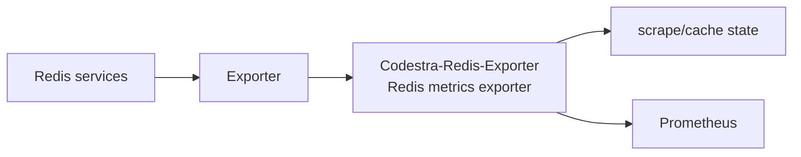
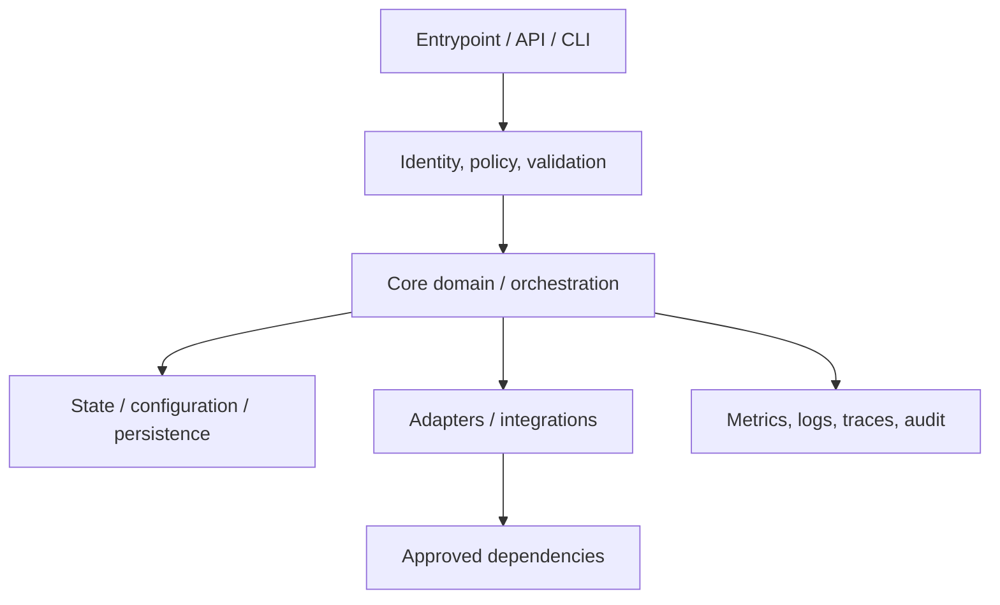
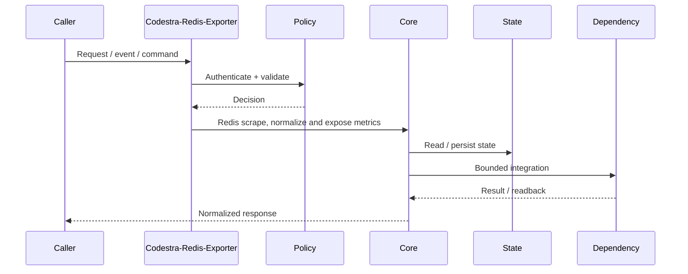
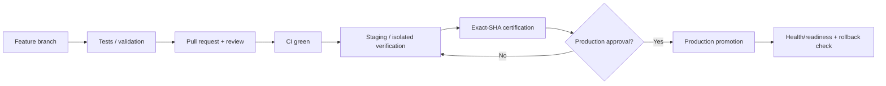
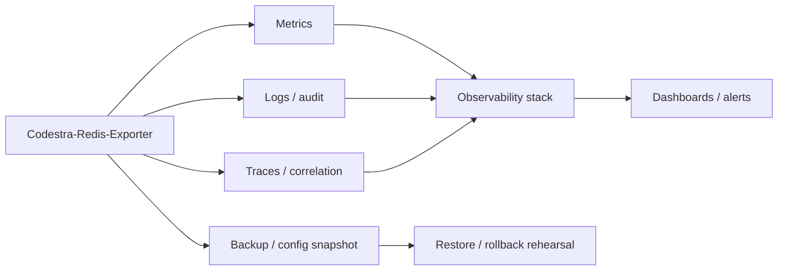

# Codestra-Redis-Exporter — Architecture Charts

> Repository: `appolon1908/Codestra-Redis-Exporter`  
> Baseline branch: `main`  
> Repository-local visual architecture. Keep these diagrams aligned with code, contracts and deployment.

## 1. System context

## 2. Internal component architecture

## 3. Critical runtime flow

## 4. Deployment and promotion

## 5. Observability and recovery

## Ownership notes
- **Role:** Redis metrics exporter
- **Primary boundary:** Exporter
- **State/config:** scrape/cache state
- **Dependencies/consumers:** Prometheus
- Cross-repository effects must use reviewed contracts; production effects remain separately gated.
